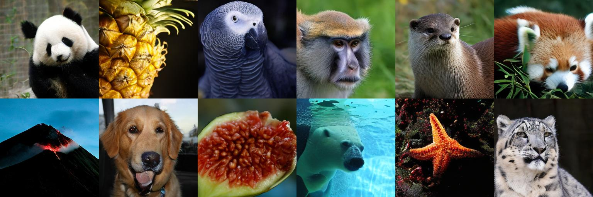

# Consistent Distribution Matching for Data-Free Diffusion Distillation

[Yuxiang Fu](https://felix-yuxiang.github.io/)<sup>1,2</sup>,
[Qi Yan](https://qiyan98.github.io/)<sup>1,2</sup>,
[Zike Wu](https://github.com/nickwzk)<sup>1,2</sup>,
[Yongxing Zhang](https://scholar.google.com/citations?user=dFsd0owAAAAJ&hl=en)<sup>1,2</sup>,
[Purang Abolmaesumi](https://ece.ubc.ca/purang-abolmaesumi/)<sup>1</sup>,
[Lele Wang](https://sites.google.com/site/wanglele1986/)<sup>1</sup>,
[Renjie Liao](https://lrjconan.github.io/)<sup>1,2,3</sup>

<sup>1</sup>University of British Columbia,
<sup>2</sup>Vector Institute for AI,
<sup>3</sup>Canada CIFAR AI Chair

[](https://arxiv.org/abs/2610.09221)
[](https://consistentdmd.github.io/)
[](#checkpoints)
<!-- TODO: Replace the Hugging Face badge target with the model repository URL. -->

More results and the method overview are available on our [project page](https://consistentdmd.github.io/).

---

<p align="center">
  
  <br>
  <em>One-step ImageNet 256×256 samples (1 NFE).</em>
</p>

## ✨ Highlights

**Consistent Distribution Matching (CDMD)** distills diffusion and flow models
for generation in one or a few steps. This repository provides the
**Lightning-DiT / ImageNet 256×256** implementation and the recipe for
**checkpoint-best**.

- **Data-free+Simulation-free training:** a frozen teacher and a trainable student, with noise and class labels sampled online.
- **One-step generation:** the public inference code reproduces **2.04 FID** on imagenet 50K images.
- **Flexible sampling:** high quality in a single step, with multi-step sampling available for inference-time steering such as reward alignment and tilt matching.

The student always uses **`gw=2.0`** during training and inference. Its learned
constant embedding is preserved in the model; there is no guidance value to tune.

<a id="quick-start"></a>

## 🏡 Environment

Install [uv](https://docs.astral.sh/uv/getting-started/installation/) and run commands
from the repository root. Inference requires a BF16-capable NVIDIA
GPU; use the pinned environment and two A100 80GB GPUs to match the reported
evaluation setup.

```bash
uv venv --python 3.11 .venv
source .venv/bin/activate
uv pip install --index-strategy unsafe-best-match -r requirements.txt
```

<a id="checkpoints"></a>

## 🎯 Checkpoints

### Lightning-DiT student

Place `consistentdmd-ldit-best.pt` in `cache/` before sampling. The compact
checkpoint is approximately 2.73 GB and contains the evaluated weights and
metadata. **Public download link pending.**

### Decoder and evaluation assets

```bash
python scripts/download_assets.py
```

The script downloads the VA-VAE, latent statistics, and ImageNet FID reference
from a pinned revision of [Peterande/FACM](https://huggingface.co/Peterande/FACM)
and verifies their SHA-256 hashes. No ImageNet images or training latents are needed.

## 🎨 Sampling and Evaluation

### Image generation

Generate 64 images in one Euler step:

```bash
bash scripts/test.sh --sampling-steps 1 --num-samples 64 --skip-metrics \
  --output-dir samples/preview
```

This saves individual PNGs and `preview.png`. Change `--sampling-steps` to
`1`, `2`, `4`, `8`, `16`, `32`, or `64`.

### FID evaluation

Reproduce the one-step FID with 50,000 images on two GPUs:

```bash
torchrun --standalone --nproc_per_node=2 test.py \
  --ckpt-path cache/consistentdmd-ldit-best.pt \
  --sampling-steps 1 --num-samples 50000 \
  --batch-size 32 --decode-batch-size 32 \
  --output-dir samples/euler-1
```

Run the complete seven-setting sweep:

```bash
NGPUS=2 bash scripts/evaluate.sh
```

Each evaluation writes `results.json`, `protocol.json`, and a preview. Scored
PNGs are removed after successful metrics; pass `--keep-samples` to retain
them. Use a fresh output directory for each run. Set `OUTPUT_DIR` to change
the sweep's output root.

The pinned torch-fidelity fork in `requirements.txt` is required for the FID
reference protocol. Recorded settings are in
[benchmarks/inference.json](benchmarks/inference.json).

<a id="results"></a>

## 📊 ImageNet 256×256 Results

One checkpoint supports all seven step counts. Each Euler step uses one model
call (NFE). Results use the reporting EMA (`sigma_rel=0.2`), 50,000 images, and
seed 0 on two A100 80GB GPUs.

| Euler steps / NFE | FID ↓ | IS ↑ |
|---:|---:|---:|
| 1 | **2.0358** | 294.30 ± 4.62 |
| 2 | 1.6185 | 311.79 ± 5.21 |
| 4 | 1.3711 | 307.30 ± 4.85 |
| 8 | **1.2764** | 313.46 ± 4.55 |
| 16 | 1.3372 | 320.47 ± 4.36 |
| 32 | 1.3798 | 319.23 ± 4.02 |
| 64 | 1.3881 | 319.51 ± 3.99 |

<a id="training"></a>

## 🚀 Training

Training starts from the pretrained Lightning-DiT teacher and draws noise and
class labels online. Use a separate environment for the A100 training stack:

```bash
uv venv --python 3.11 .venv-train
source .venv-train/bin/activate
uv pip install --index-strategy unsafe-best-match -r requirements-train.txt
python scripts/download_assets.py --training
NGPUS=8 bash scripts/train.sh
```

[configs/train.yaml](configs/train.yaml) sets the portable recipe, effective batch **1024**, microbatch **32**, BF16, FA2, seed **42**,
and learning rate **`1e-4`**. Accumulation is calculated for the GPU count.

Set `m_ratio` in the YAML config or pass `--m-ratio` to control the probability
of using fresh-noise interpolation toward the student's endpoint. It accepts
values from `0` to `1`; the remaining samples use the student's direct trajectory.
The default **`0.5`** preserves the checkpoint-best training behavior.

```bash
NGPUS=8 bash scripts/train.sh --m-ratio 0.75
```

The YAML also sets `t_logit_mean`, `t_logit_std`, `r_logit_mean`, and `r_logit_std`
for the normal draws before sigmoid and sorting (`t <= r`). Teacher guidance uses `teacher_cfg_scale`
inside the inclusive interval `[teacher_cfg_min, teacher_cfg_max]` and
`teacher_cfg_outside_scale` outside it. The defaults preserve checkpoint-best
training; student guidance remains fixed at `gw=2.0`.

The released weights were trained through historical continuations with
different batch sizes and hardware. This recipe preserves the architecture
and objective, but does not reproduce that trajectory bitwise. Use the
checkpoint-best weights to reproduce the evaluation results.

<details>
<summary><b>Training backend and native resume</b></summary>

The default `fa2` option uses the bundled Triton JVP kernel; ordinary model
calls use PyTorch SDPA. No separate FlashAttention package is required.
`--attn-func base` selects manual attention for debugging. GPU memory must
hold the student, frozen teacher, training EMA, and VA-VAE decoder.

Checkpoints save the optimizer, scheduler, training and reporting EMAs, and
every rank's RNG state. Resume with the same GPU count, microbatch, `m_ratio`,
time-sampling settings, and teacher guidance:

```bash
NGPUS=8 bash scripts/train.sh \
  --resume outputs/train/checkpoints/latest.json
```

The trainer retains the latest two checkpoints and the best checkpoint.

</details>

<details>
<summary><b>Optional W&amp;B logging</b></summary>

Run `uv pip install wandb==0.26.0` and pass `--wandb` to enable logging. For a linked continuation,
also pass `--wandb-parent-run entity/project/run-id` and set `WANDB_ENTITY`
and a new `WANDB_RUN_ID`. The run ID and URL are saved in `wandb_run.json`
and reused when resuming the same output directory. Preview images and
scalar logs are also available without W&B. Automatic code, Git, console,
machine metadata, system-stat collection, and SDK error reporting are disabled. Logged configuration
omits local asset and checkpoint paths; explicit parent-run links are retained.

</details>

<details>
<summary><b>Repository layout</b></summary>

| Files | Purpose |
|---|---|
| [train.py](train.py), [losses.py](losses.py) | Training and the consistency/flow-matching objective |
| [test.py](test.py), [sampler.py](sampler.py) | Image generation and Euler sampling |
| [ldit/](ldit/) | Lightning-DiT, VA-VAE decoder, and attention JVP kernel |
| [utils/](utils/) | Checkpoints, EMA, and FID/IS evaluation |
| [scripts/](scripts/) | Launchers, asset download, and checkpoint export |

</details>

## ✅ Checklist

- [x] ~~Paper and project page~~
- [x] ~~Lightning-DiT training code~~
- [x] ~~Sampling and FID/IS evaluation code~~
- [x] ~~Make the GitHub repository public~~s
- [ ] Upload checkpoint-best to Hugging Face
- [ ] Add the checkpoint download link and update the Hugging Face badge

## 🎉 Acknowledgements and License

This implementation builds on [FACM](https://github.com/ali-vilab/FACM),
[Lightning-DiT](https://github.com/hustvl/LightningDiT),
[DiT](https://github.com/facebookresearch/DiT), ema-pytorch, and the LTH14
torch-fidelity fork. We thank [DMF](https://github.com/kyungmnlee/dmf) for the
[Python FlashAttention JVP implementation](https://github.com/kyungmnlee/dmf/tree/main/models)
used by our training code. See [THIRD_PARTY_NOTICES.md](THIRD_PARTY_NOTICES.md)
and [LICENSE.md](LICENSE.md) for attribution and licenses.

## 🔮 Citation

If you use this code or the released weights, please cite our paper:

```bibtex
@article{fu2026cdmd,
  title   = {Consistent Distribution Matching for Data-Free Diffusion Distillation},
  author  = {Fu, Yuxiang and Yan, Qi and Wu, Zike and Zhang, Yongxing and
             Abolmaesumi, Purang and Wang, Lele and Liao, Renjie},
  journal = {arXiv preprint arXiv:2610.09221},
  year    = {2026},
  url     = {https://arxiv.org/abs/2610.09221}
}
```


